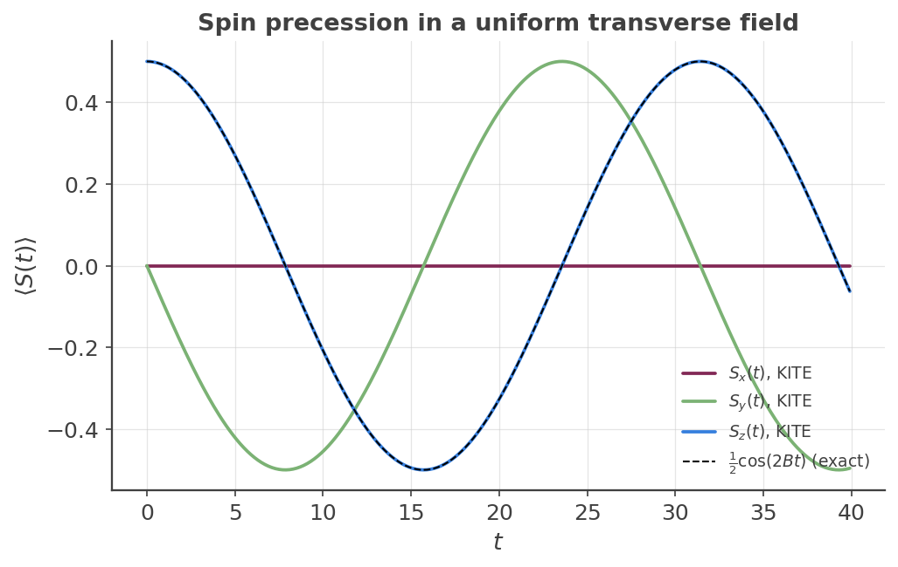

## Real-time evolution of a wave packet

Most calculations on this site are static, energy-resolved spectral properties -- a density of
states, a local density of states, a spectral function -- computed once and for all from the
Hamiltonian's spectrum, not a response to any perturbation. Others (conductivity, spin Hall
response) genuinely are linear-response coefficients.
[`#!python calculation.gaussian_wave_packet()`][calculation-gaussian_wave_packet] is the member of
this family introduced here: it builds a Gaussian-enveloped wave packet and propagates it **in real
time**, using a Chebyshev expansion of $e^{-iHt}$, then reports the expectation value of whatever
operators you ask for at every timestep. This page is a from-scratch introduction to that
feature, using the simplest possible physical system it can demonstrate.

**Time units.** With $\hbar=1$ (KITE's convention throughout), a physical time has units of
inverse energy. The `#!python timestep` argument is specified in the same rescaled units as the
internal Hamiltonian $\hat H/\mathtt{energy\_scale}$ (`#!python energy_scale` is the
`#!python Configuration` parameter that maps the model's physical energy units onto KITE's
required $[-1,1]$ Chebyshev spectral range); to convert a rescaled timestep back to physical time,
divide by `#!python energy_scale` expressed in the same energy units used to define the model's
hoppings.

### The physics: spin precession in a field

A spin-$\tfrac12$ placed in a uniform transverse field $B$ (a textbook Larmor-precession
problem) has Hamiltonian $\hat H = B\hat\sigma_x$. Starting from the $S_z=+\tfrac12$
eigenstate, the exact solution is

$$
\langle S_z(t)\rangle = \tfrac12\cos(2Bt), \qquad
\langle S_y(t)\rangle = -\tfrac12\sin(2Bt), \qquad
\langle S_x(t)\rangle = 0 \ \ \forall t.
$$

`#!python examples/spin_precession_simple.py` realizes exactly this on an ordinary square
lattice: two orbitals ("up","down") at every site, identical plain nearest-neighbor hopping
$-t$ for both (the kinetic part carries no spin information at all), and a single on-site
term coupling them,

``` python
lat.add_hoppings(
    ([1, 0], 'up', 'up', -t),
    ([0, 1], 'up', 'up', -t),
    ([1, 0], 'down', 'down', -t),
    ([0, 1], 'down', 'down', -t),
    ([0, 0], 'up', 'down', B),   # on-site transverse field, B*sigma_x
)
```

!!! Info "This is a toy model, not a simulated magnetic field"

    $B$ is a bare on-site coupling constant with the mathematical structure of a transverse
    Zeeman term — there is no vector potential, no Peierls substitution, no g-factor, and no
    coupling to a real electromagnetic field anywhere in this construction. The hopping $-t$ is
    likewise pure numerical scaffolding: KITE's real-space method needs an extended periodic
    lattice, so it can't simulate a literal isolated two-level system, but $t$ carries no
    physics of its own here (identical for both orbitals, it drops out of the spin dynamics
    entirely — see below). The only thing this model is meant to demonstrate is the propagator
    and the operator-tracking mechanism, on the simplest Hamiltonian that shows real precession.

Only the single `#!python ([0, 0], 'up', 'down', B)` line needs to be given — KITE completes it
into the full Hermitian $2\times2$ matrix automatically. Whenever a hopping is registered at
`#!python relative_index=[0, 0]` between two different sublattices, the lattice-export step adds
the reverse-direction term with the conjugate-transposed value for you (the same is true, at
`#!python -relative_index`, for any nonzero bond); see `#!python config_system()`'s internals if
you want to check this yourself. Every other example on this site relies on the same
auto-completion — only one direction of each bond is ever written out explicitly.

Because the field term doesn't depend on $k$ and the kinetic part is identical for both
orbitals, the full Bloch Hamiltonian factorizes exactly as $H(k)=\varepsilon(k)\hat I+B\hat\sigma_x$
at *every* $k$ — so the precession above holds exactly, for a wave packet of any width or
shape, with **no dephasing**. This is a special case: whenever the tracked operator's coupling
is $k$-dependent instead, a finite-width wave packet dephases from its own momentum spread —
a genuinely different, more advanced regime.

### Tracking an operator during propagation

`#!python gaussian_wave_packet()` has no built-in notion of spin or any other operator: whatever
you want to track is registered the same way as [`#!python custom_one()`][calculation-custom_one]'s
vertex operators, via [`#!python add_orbital_coupling()`][calculation-add_orbital_coupling], then
passed in as `#!python operators=[...]`:

``` python
calculation.add_orbital_index('up', 0)
calculation.add_orbital_index('down', 1)

calculation.add_orbital_coupling('down', 'up', 0.5, 'l0')   # S_x
calculation.add_orbital_coupling('up', 'down', 0.5, 'l0')
calculation.add_orbital_coupling('down', 'up', -0.5j, 'l1')  # S_y
calculation.add_orbital_coupling('up', 'down', 0.5j, 'l1')
calculation.add_orbital_coupling('up', 'up', 0.5, 'l2')      # S_z
calculation.add_orbital_coupling('down', 'down', -0.5, 'l2')

calculation.gaussian_wave_packet(
    num_points=400, num_moments=256, num_disorder=1,
    k_vector=[[0.0, 0.0]], spinor=[[1.0, 0.0]], width=4.0, timestep=0.5,
    mean_value=[64, 64], operators=['l0', 'l1', 'l2'])
```

The `#!python spinor=[[1.0, 0.0]]` seeds the wave packet purely in the "up" orbital — the
$S_z=+\tfrac12$ eigenstate.

!!! warning "The spinor is an orbital amplitude, not a band amplitude"

    `#!python spinor` gives the amplitude on each **orbital** of the unit cell, in the
    order the sublattices were added. KITE seeds that vector directly — it does not
    project onto the eigenstates of $H(\mathbf{k})$ — so unless what you pass happens to
    be an eigenvector, the packet starts with weight in several bands and its evolution
    carries each of their frequencies.

    That is what happens here, and it is the mechanism of the example rather than a flaw
    in it. The orbitals *are* `up` and `down`, so the orbital basis is the $S_z$ basis, and
    $H(\mathbf{k}) = \varepsilon(\mathbf{k})\hat I + B\hat\sigma_x$ has eigenstates
    $(1,\pm 1)/\sqrt2$ at energies $\varepsilon(\mathbf{k}) \pm B$. The seeded $(1,0)$
    therefore puts exactly half its weight in each, and the $\tfrac12\cos(2Bt)$ you see is
    the beat between the two.

    To seed an eigenstate instead, pass one: $(1,1)/\sqrt2$ leaves
    $\langle S_x\rangle$ at $+\tfrac12$ and nothing precesses. Starting from
    $(1,\mathrm{i})/\sqrt2$ gives the same precession in the $y$–$z$ plane,
    $\langle S_y\rangle = \tfrac12\cos(2Bt)$ and $\langle S_z\rangle = \tfrac12\sin(2Bt)$.

    On a lattice whose orbitals are not spin — honeycomb's $A$ and $B$ sublattices, say —
    the same $(1,0)$ means "all weight on $A$", which is again an equal superposition of
    the two bands, but of nothing you would call a spin state.

!!! warning "The spinor is held fixed across the packet's momentum spread"

    `#!python width` is a real-space length in the same units as the lattice vectors, so
    the packet covers a momentum range $\Delta k\approx 1/\texttt{width}$ around each $k$
    you list, and the spinor you gave for that $k$ is applied unchanged across the whole
    range. Seeding an eigenvector of $H(\mathbf{k})$ therefore gives a single-band packet
    only where that eigenvector varies little over $\Delta k$; near a band touching or an
    avoided crossing it does not, and part of the weight sits in the other band.
    `#!python spinor` takes one row per $k$-vector, so you can follow the eigenvector
    across the packet where that matters.

    It does not arise in the example above: $H(\mathbf{k})=\varepsilon(\mathbf{k})\hat I+B\hat\sigma_x$
    has $k$-independent eigenvectors, so any width is safe.

!!! note "`#!python k_vector` is fractional, `#!python hamiltonian_k()` is Cartesian"

    `#!python k_vector` is given in fractional coordinates — components along the
    reciprocal lattice vectors — so graphene's $K$ point is `#!python [1/3, -1/3]`, not its
    Cartesian value. [`#!python kite.visualize.hamiltonian_k()`][visualize-hamiltonian_k]
    takes Cartesian $k$, so if you diagonalize $H(\mathbf{k})$ to choose a spinor, convert
    before seeding:

    ``` python
    vectors = np.asarray(lattice.vectors)
    vectors = vectors[:, :vectors.shape[0]]
    k_frac = k_cart @ vectors.T / (2 * np.pi)
    ```

    Passing a Cartesian $k$ straight to `#!python gaussian_wave_packet()` seeds a different
    momentum, with no error.

As with `#!python custom_one()`/`#!python custom_two()`, this
mechanism has one hard restriction worth knowing up front: a tracked operator must be a single
on-site matrix, identical at every site — it cannot represent a quantity that couples different
lattice sites (see the warning under
[`#!python add_orbital_coupling()`][calculation-add_orbital_coupling]).

### Validation

<figure>
    
    <figcaption>KITE's Sx, Sy, Sz (solid) exactly overlay the analytic prediction (dashed). Sx
    stays at zero throughout; Sy, Sz precess a full period with no visible damping, matching a
    machine-precision (~1e-13) comparison against the exact solution.</figcaption>
</figure>

KITE's output matches the exact analytic solution to machine precision ($\max|\Delta S_z|\approx
6\times10^{-14}$) over more than one full precession period — a strong, cheap correctness check
for both the propagator and the operator-registration mechanism.

!!! example

    Get more familiar with KITE: run [`#!python examples/spin_precession_simple.py`][precession-example]
    and its post-processing yourself, and try changing $B$ (the precession frequency scales as
    $2B$) or seeding a different initial spinor (e.g. an $S_x$ eigenstate) to see a different
    precession plane.

[calculation-gaussian_wave_packet]: ../../api/kite.md#calculation-gaussian_wave_packet
[calculation-custom_one]: ../../api/kite.md#calculation-custom_one
[calculation-add_orbital_coupling]: ../../api/kite.md#calculation-add_orbital_coupling
[visualize-hamiltonian_k]: ../../api/kite.md#visualize-hamiltonian_k
[precession-example]: https://github.com/quantum-kite/kite-v2/tree/master/examples/spin_precession_simple.py
